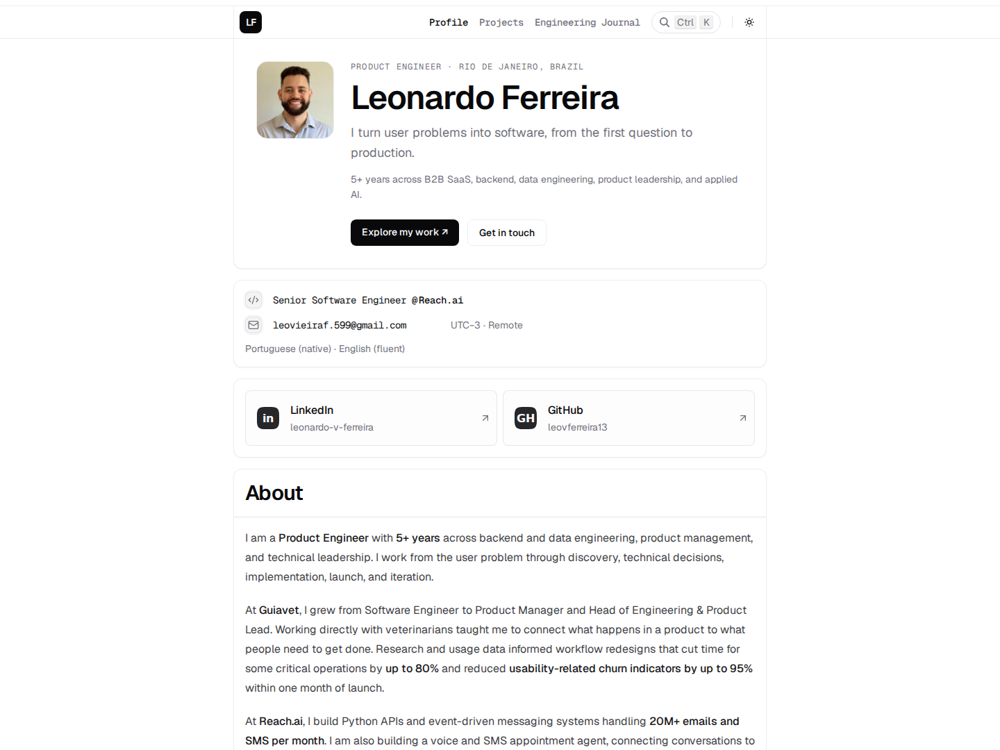

# Leonardo Ferreira · Product Engineer

My professional portfolio: the products I have worked on, the problems I help solve, and the decisions behind what I build.

**[LinkedIn](https://www.linkedin.com/in/leonardo-v-ferreira)** · **[GitHub](https://github.com/leovferreira13)** · **[Contact](mailto:leovieiraf.599@gmail.com)**

<!-- deployment-url:start -->

**Website:** not published yet. The production link will be added after the first Railway deployment.

<!-- deployment-url:end -->



## About me

I am a Product Engineer based in Rio de Janeiro, with 5+ years across backend and data engineering, product management, and technical leadership. I work from discovery through launch and iteration, combining user context with hands-on engineering.

At Guiavet, I progressed from Software Engineer to Product Manager and Head of Engineering & Product Lead, building veterinary SaaS workflows and leading a team of five engineers. At Reach.ai, I build Python APIs, event-driven messaging systems, and a voice/SMS appointment agent with retrieval, tool calling, evaluations, and observability.

## Explore the portfolio

| Area                               | What it contains                                                                                |
| ---------------------------------- | ----------------------------------------------------------------------------------------------- |
| **Profile** `/`                    | Product Engineer narrative, experience, capabilities, education, publication, and contact links |
| **Projects** `/projects`           | Curated public work with a live app, source repository, and associated engineering notes        |
| **Engineering Journal** `/journal` | Dated decisions, releases, experiments, and retrospectives, filterable by project               |

### First public project: Football, Visualized

An interactive football analytics app connecting a reproducible StatsBomb Open Data pipeline, XGBoost training and evaluation, browser inference, and a five-language Next.js playground.

**[Open the live app](https://sports-data-visualizer-production.up.railway.app/en)** · **[Read the source](https://github.com/leovferreira13/sports-data-visualizer)**

The journal intentionally starts empty. There are no sample posts presented as my work. Future entries link to a project and can reference the specific PR, commit, release, or evaluation behind a decision.

## Run locally

Requirements: Node.js 22 and pnpm 10.33.0 (the version pinned in `package.json`).

```bash
corepack enable
pnpm install --frozen-lockfile
cp .env.example .env.local
pnpm dev
```

Open **http://localhost:3000**. Core pages require no database, API key, or analytics service.

```bash
pnpm check-types
pnpm lint
pnpm test:content
pnpm build
pnpm start
```

Optional: `pnpm dev:portless` uses an existing global Portless installation.

## Publish on Railway

1. Create a Railway service from this GitHub repository after merging the implementation.
2. Use the repository root. `railway.toml` supplies the build, start, and health-check configuration.
3. Generate a public domain. Set `APP_URL` to its complete HTTPS origin, for example `https://your-portfolio.up.railway.app`. Railway's `RAILWAY_PUBLIC_DOMAIN` is also detected automatically. Rebuild after changing the URL so static metadata, RSS, and sitemap agree.
4. Confirm `/`, `/projects`, `/journal`, `/journal/rss`, `/robots.txt`, and `/sitemap.xml` at the deployed origin.
5. Update the README's production link with the actual, verified URL:

```bash
pnpm site:url https://your-portfolio.up.railway.app
```

`site:url` updates only this README; configure `APP_URL` in Railway separately. Without a public origin, previews stay `noindex` and the sitemap is empty. No production domain is assumed or invented.

See [deployment notes](docs/DEPLOYMENT.md) for details.

## Add projects and journal entries

- Add public projects in [`src/features/portfolio/data/projects.ts`](src/features/portfolio/data/projects.ts), with a stable `id`, real links, context, technologies, and an optional screenshot.
- Copy [`docs/templates/journal-entry.mdx.example`](docs/templates/journal-entry.mdx.example) to `src/features/doc/content/<descriptive-slug>.mdx`.
- Keep `status: "draft"` while writing. Set the matching `projectId`, entry type, dates, tags, and evidence links. Publish with `status: "published"` and rebuild/deploy.
- Drafts and future-dated entries stay out of pages, navigation, RSS, sitemap, and text exports. The publication date uses UTC; future entries need a new build/deploy on or after that date.

Read the [journal authoring guide](docs/JOURNAL.md) for the content contract and workflow.

## Capture the profile

With the site running locally:

```bash
pnpm capture:portfolio
```

This regenerates `docs/screenshots/profile.png` and a mobile capture using Puppeteer. Set `PORTFOLIO_BASE_URL` if the server is not at `http://localhost:3000`. Screenshots are real browser renders, not design mockups.

## Architecture

Next.js 16 App Router, React 19, strict TypeScript, Tailwind CSS v4, and MDX. Professional data is curated in `src/features/portfolio/data/`; journal entries use the shared MDX store with an explicit publication contract. There is no CMS or runtime database to operate.

| Document                             | Purpose                                           |
| ------------------------------------ | ------------------------------------------------- |
| [Architecture](docs/ARCHITECTURE.md) | Code map and active architecture decisions        |
| [Journal](docs/JOURNAL.md)           | Entry schema, publishing, and editorial guidance  |
| [Deployment](docs/DEPLOYMENT.md)     | Railway configuration and production verification |
| [Vision](docs/VISION.md)             | Portfolio purpose and product direction           |
| [Agent guidance](AGENTS.md)          | Repository conventions and contribution workflow  |

The inherited component registry remains available in the source for reuse, outside the portfolio's navigation, journal, sitemap, and profile exports.

## Credits

Based on [Chánh Đại's open-source portfolio](https://github.com/ncdai/chanhdai.com). Its MIT license and copyright notice are preserved in [LICENSE](LICENSE). The profile content, curated projects, and journal structure have been adapted for Leonardo Ferreira.

The Football, Visualized screenshot is from [sports-data-visualizer](https://github.com/leovferreira13/sports-data-visualizer). That project uses StatsBomb Open Data under its own attribution and non-commercial-use terms; see its README for data provenance and permissions. This portfolio does not redistribute its datasets.
